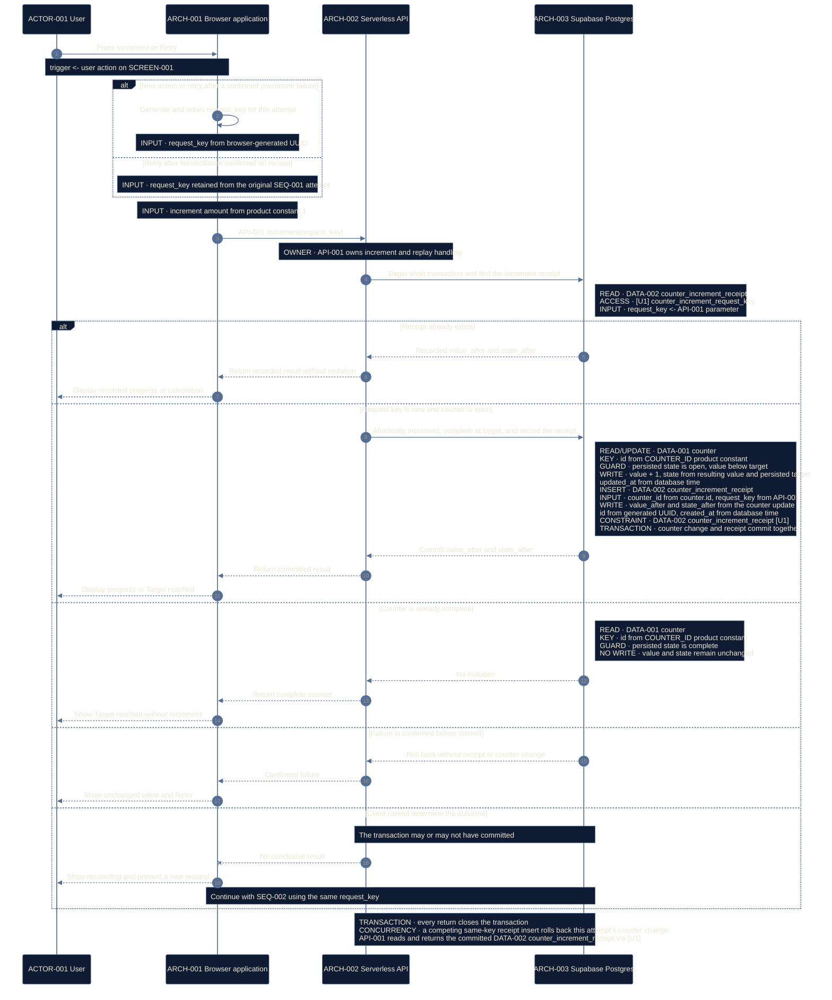
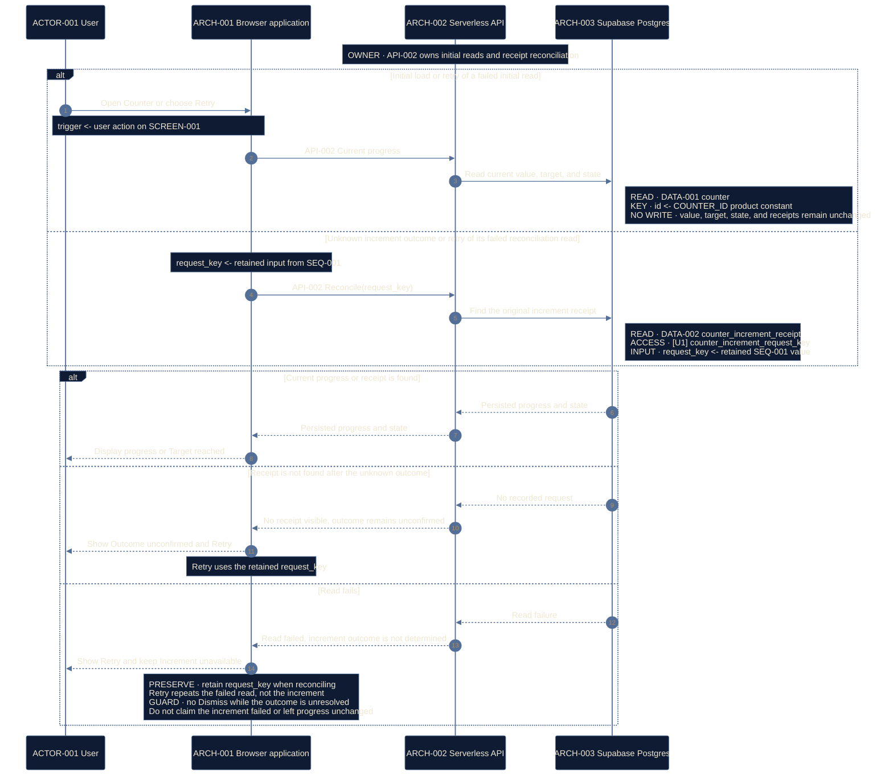
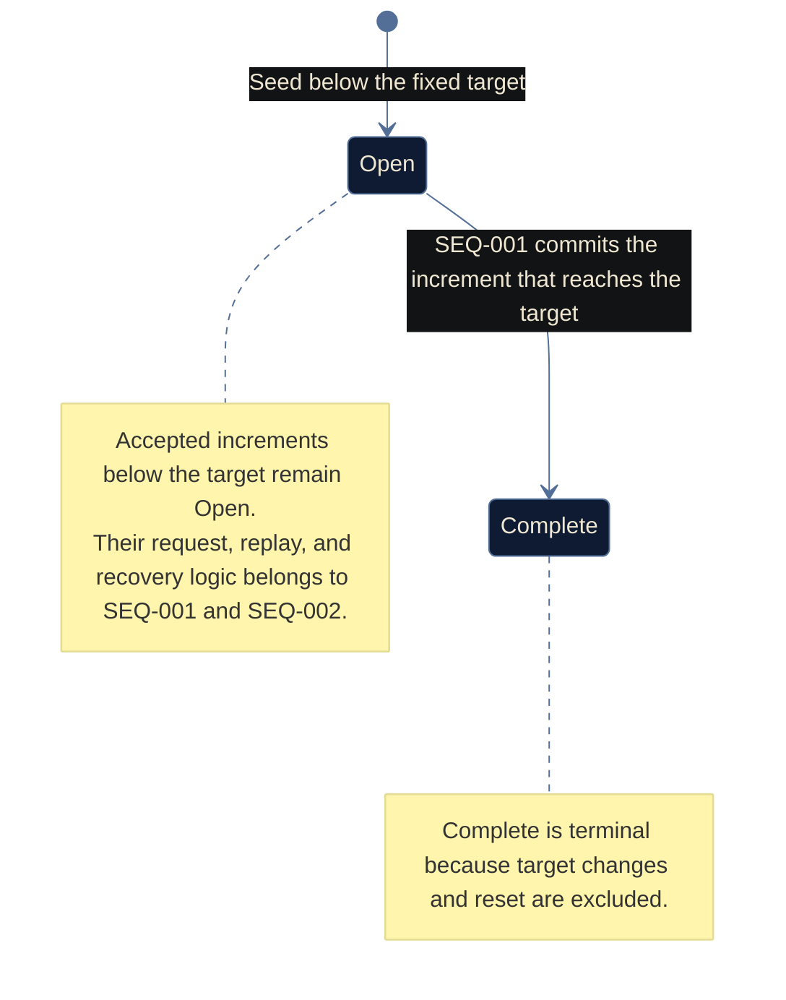

# Counter logic

Counter's sequences, rule, lifecycle, and quality targets live together so one
process reads in one file.

## SEQ-001 Increment once

This diagram owns the increment and replay logic of
[RULE-001](#rule-001-persist-and-present-the-counter-safely) for
[DATA-001 and DATA-002](data-counter.md) during
[FLOW-001](experience-counter.md#flow-001-read-and-increment-the-counter).

**DCL:** 4 (product default)

### Current rationale

- The browser creates one request key for a new action and retains it through
  reconciliation because a network failure must not turn uncertainty into a
  second product action. When reconciliation finds no receipt, Retry uses the
  original key; a known precommit failure may start a new attempt with a new key.
- The API checks `[U1]` before mutation and returns an existing receipt because
  replaying a recorded request is a read, not another increment.
- The counter update, completion transition, and receipt insert share one short
  transaction because partial commit would make progress, state, and replay
  protection disagree.
- A failure known to occur before commit may offer Retry because the value and
  receipt are known to be unchanged.
- An unknown outcome does not create a new request because the first transaction
  may already have committed; `SEQ-002` reconciles the original key.

## SEQ-002 Load or reconcile progress

This sequence loads [DATA-001](data-counter.md) initially and resolves an
unknown [SEQ-001](#seq-001-increment-once) outcome through DATA-002 during
[FLOW-001](experience-counter.md#flow-001-read-and-increment-the-counter).

**DCL:** 4 (product default)

### Current rationale

- Initial load and reconciliation share one read process because each must
  return authoritative progress without creating a new product action.
- Reconciliation looks up the original request receipt rather than inferring
  success from the latest counter value because other users may have advanced
  the counter afterward.
- A missing receipt permits Retry only with the retained request key because a
  concurrent original transaction and its retry must still resolve to one
  `[U1]` receipt.
- Increment remains unavailable after a read failure because the browser cannot
  safely present or mutate progress it has not reconciled.

## RULE-001 Persist and present the counter safely

`RULE-001` applies to `CAP-001`. Its logic is owned by the steps where it runs:
the request-key replay check, atomic increment and completion, and receipt
insert in [SEQ-001](#seq-001-increment-once), and the initial load and
original-key reconciliation in
[SEQ-002](#seq-002-load-or-reconcile-progress). The visible results appear in
[FLOW-001](experience-counter.md#flow-001-read-and-increment-the-counter).

## SM-001 Counter lifecycle

### Current rationale

- `Open` and `Complete` are separate durable states because they allow different
  product actions: Open permits Increment, while Complete does not.
- Increments below the target are intentionally absent as self-loops because
  they do not change the stable lifecycle state; `SEQ-001` owns their detailed
  request, transaction, replay, and failure logic.
- Completion is terminal because changing or resetting the fixed target is
  outside this release.

## Quality targets

| ID | Applies to | Measure | Target |
| --- | --- | --- | --- |
| `QC-001` | `CAP-001`, [SEQ-001](#seq-001-increment-once) | Accepted increment latency, receipt uniqueness, and persistence consistency under concurrent load | p95 latency is no more than 500 milliseconds at 10 requests per second, with no lost or duplicate accepted increments |
| `QC-002` | `CAP-001`, [DATA-001 and DATA-002](data-counter.md) | Retention of persisted counter and receipt state across application deployment and rollback | Deployment and rollback do not reset persisted counter or receipt state; backups are maintained for recovery |
